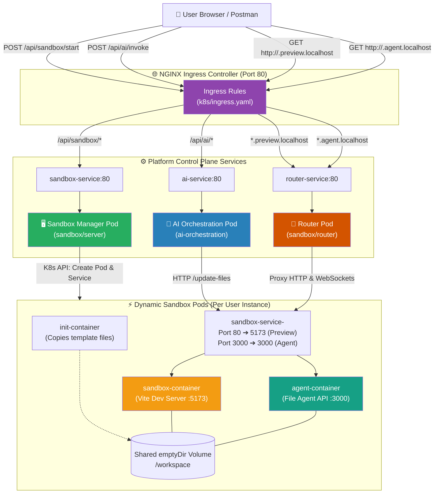

# 🚀 Cloud-Native AI Coding Sandbox Platform

> **An isolated, on-demand cloud coding sandbox platform (inspired by CodeSandbox, Replit, and GitHub Codespaces) integrated with an autonomous AI coding agent powered by LangChain and Google Gemini.**

Every user gets their own isolated Kubernetes sandbox running a live React 19 + Vite application. An AI coding agent can inspect, read, and rewrite workspace code on demand, triggering instant Hot Module Replacement (HMR) in the user's browser.

---

## 🎯 Architecture & Core Capabilities

- **On-Demand Sandbox Provisioning:** Instant allocation of isolated sandbox pods via Kubernetes Core API (`POST /api/sandbox/start`).
- **Multi-Container Pod Architecture:**
  - `init-container`: Populates clean Vite React template files into a shared volume.
  - `sandbox-container`: Runs the Vite development server on port `5173`.
  - `agent-container`: Sidecar Express service on port `3000` providing file manipulation APIs (`/list-files`, `/read-files`, `/update-files`, `/create-files`) over the shared `/workspace` volume.
- **Autonomous AI Coding Agent (`ai-orchestration`):**
  - Built with **LangChain** and **Google Gemini GenAI**.
  - Intelligent fallback chain (`gemini-3.5-flash-lite` → `gemini-3.6-flash` → `gemini-3.1-flash-lite`) to bypass rate limits and temporary spikes in demand.
  - Dynamic tool creation binding directly to the targeted sandbox's internal cluster service (`http://sandbox-service-<id>:3000`).
- **Dynamic Reverse Proxy Router (`sandbox/router`):**
  - Inspects incoming subdomains (`*.preview.localhost` and `*.agent.localhost`).
  - Proxies HTTP and WebSocket traffic (for Vite HMR) with connection memoization and caching.
- **Single-Command Local Dev with Skaffold:**
  - Manages 5 container images (`ai-orchestration`, `agent`, `router`, `sandbox`, `template`).
  - Automatic builds, image loading into Kind/Docker Desktop, manifests deployment, and live source sync.

---

## 📁 Repository Structure

```
capstone/
├── 📂 ai-orchestration/           ← 🤖 AI Coding Agent microservice (LangChain + Gemini)
│   ├── server.js                  ← Service entrypoint (Port 3000)
│   ├── dockerfile                 ← Node 22 Alpine container spec
│   ├── package.json               ← LangChain, Google GenAI dependencies
│   └── 📂 src/
│       ├── app.js                 ← Express app with /api/ai/invoke & health routes
│       ├── 📂 agents/
│       │   ├── code.agent.js      ← ReAct agent loop with multi-model fallback chain
│       │   └── tools.js           ← Dynamic sandbox tools (listFiles, readFiles, updateFiles)
│       └── 📂 routes/
│           └── agnets.routes.js   ← API route handler for /api/ai/invoke
│
├── 📂 sandbox/                    ← 📦 Sandbox System & Execution Environments
│   ├── 📂 server/                 ← 🖥️ Sandbox Manager / Control Plane API
│   │   ├── server.js              ← Entrypoint (Port 3000)
│   │   ├── dockerfile             ← Container spec
│   │   └── 📂 src/
│   │       ├── app.js             ← Express app (/api/sandbox/start, /health)
│   │       └── 📂 kubernetes/
│   │           ├── config.js      ← In-cluster K8s client initialization
│   │           ├── pod.js         ← Pod generator (multi-container + emptyDir volume)
│   │           └── service.js     ← ClusterIP service generator (ports 80 & 3000)
│   │
│   ├── 📂 router/                 ← 🔀 Dynamic Subdomain Reverse Proxy
│   │   ├── server.js              ← Entrypoint (Port 3000)
│   │   ├── dockerfile             ← Container spec
│   │   └── 📂 src/
│   │       └── app.js             ← Dynamic proxy routing for preview & agent hosts
│   │
│   ├── 📂 agent/                  ← 🛠️ Sandbox Sidecar File Manager
│   │   ├── server.js              ← Entrypoint (Port 3000)
│   │   ├── dockerfile             ← Container spec
│   │   └── 📂 src/
│   │       └── app.js             ← /list-files, /read-files, /update-files APIs
│   │
│   └── 📂 template/               ← ⚡ React 19 + Vite Starter Project
│       ├── index.html             ← Frontend HTML entrypoint
│       ├── vite.config.js         ← Vite dev server config (0.0.0.0:5173, allowedHosts)
│       ├── package.json           ← React 19, Vite 8, Tailwind/CSS dependencies
│       └── 📂 src/
│           ├── main.jsx           ← React DOM entrypoint
│           ├── App.jsx            ← Starter React application component
│           └── App.css            ← Component styles
│
├── 📂 k8s/                        ← ☸️ Kubernetes Manifests
│   ├── ai-deployment.yaml         ← AI Orchestration deployment (1GB RAM limits)
│   ├── ai-service.yaml            ← AI Orchestration ClusterIP service
│   ├── sandbox-deployment.yaml    ← Sandbox API Server deployment
│   ├── sandbox-service.yaml       ← Sandbox API Server ClusterIP service
│   ├── router-deployment.yaml     ← Router reverse proxy deployment
│   ├── router-service.yaml        ← Router ClusterIP service
│   ├── ingress.yaml               ← NGINX Ingress rules with 300s timeout annotations
│   └── rbac.yaml                  ← ServiceAccount & Role for resource-manager
│
├── skaffold.yaml                  ← 🚀 Skaffold development lifecycle configuration
├── 📂 auth/                       ← 🔐 Authentication service (modular extension)
└── 📂 notification/               ← 🔔 Notification service (modular extension)
```

---

## 🔗 Architecture & Request Routing



---

## 🔄 End-to-End Workflows

### 1. Provisioning a Sandbox
1. Client sends `POST http://localhost/api/sandbox/start`.
2. Ingress routes the request to `sandbox-service:80` → `sandbox/server`.
3. Server generates a unique `sandboxId` (UUID v7).
4. Server makes parallel Kubernetes API calls using the `resource-manager` ServiceAccount:
   - Creates `sandbox-pod-<sandboxId>` containing `init-container`, `sandbox-container` (port 5173), and `agent-container` (port 3000).
   - Creates `sandbox-service-<sandboxId>` mapping port 80 to 5173 and port 3000 to 3000.
5. Returns `sandboxId` and `previewUrl: http://<sandboxId>.preview.localhost`.

### 2. Invoking the Autonomous AI Agent
1. Client sends `POST http://localhost/api/ai/invoke` with:
   ```json
   {
     "sandboxId": "01a1ac0e-7a6a-730a-a02e-8e1665ef6fb8",
     "messages": [
       { "role": "user", "content": "Create a fully functional Snake Game in React with modern CSS styling" }
     ]
   }
   ```
2. `ai-orchestration` initializes a LangChain ReAct agent equipped with sandbox-specific tools:
   - `listFiles`: Queries `http://sandbox-service-<id>:3000/list-files`
   - `readFiles`: Queries `http://sandbox-service-<id>:3000/read-files?files=src/App.jsx,src/App.css`
   - `updateFiles`: Dispatches PATCH to `http://sandbox-service-<id>:3000/update-files`
3. Agent analyzes existing workspace files, generates the code, and saves it into `/workspace/src/App.jsx` and `/workspace/src/App.css`.
4. Vite dev server detects the file modification on the shared volume and triggers instant **Hot Module Replacement (HMR)**.
5. The user's open browser preview reflects the new game without needing a page refresh!

### 3. Accessing the Live Preview
1. User navigates to `http://<sandboxId>.preview.localhost`.
2. Ingress routes `*.preview.localhost` to `router-service:80`.
3. Router parses the subdomain, extracts `<sandboxId>`, and routes to internal target `http://sandbox-service-<sandboxId>:80`.
4. Vite returns the React application HTML/JS/CSS assets and establishes a WebSocket connection for live reloading.

---

## 🚀 Getting Started

### Prerequisites
- [Docker Desktop](https://www.docker.com/) with Kubernetes enabled (or [Kind](https://kind.sigs.k8s.io/))
- [kubectl](https://kubernetes.io/docs/tasks/tools/)
- [Skaffold](https://skaffold.dev/) (v2+)
- NGINX Ingress Controller installed in the cluster:
  ```bash
  kubectl apply -f https://raw.githubusercontent.com/kubernetes/ingress-nginx/controller-v1.11.1/deploy/static/provider/cloud/deploy.yaml
  ```
- Google Gemini API Key from [Google AI Studio](https://aistudio.google.com/)

### 1. Configure Kubernetes Secrets
Store your Gemini API key in the Kubernetes secret consumed by `ai-orchestration`:

```bash
kubectl create secret generic ai-secret \
  --from-literal=GEMINI_API_KEY="YOUR_GEMINI_API_KEY" \
  --dry-run=client -o yaml | kubectl apply -f -
```

### 2. Launch Development Environment with Skaffold
From the root repository directory:

```powershell
skaffold dev
```

Skaffold will automatically:
1. Build all 5 container images (`ai-orchestration`, `agent`, `router`, `sandbox`, `template`).
2. Load images into the local Kubernetes cluster.
3. Apply all Kubernetes manifests in `k8s/`.
4. Stream logs and hot-reload changes on file edits.

### 3. Verify Deployment
```powershell
kubectl get pods
```
All core pods (`ai-deployment`, `router-deployment`, `sandbox-deployment`) should transition to `Running` status.

---

## 🧪 Testing the API

### Start a Sandbox
```powershell
$res = Invoke-RestMethod -Uri "http://localhost/api/sandbox/start" -Method POST -ContentType "application/json"
$res
```
Output:
```json
{
  "message": "Sandbox started successfully",
  "sandboxId": "01a1ac0e-7a6a-730a-a02e-8e1665ef6fb8",
  "previewUrl": "http://01a1ac0e-7a6a-730a-a02e-8e1665ef6fb8.preview.localhost"
}
```

### Invoke AI to Build an App
```powershell
$body = @{
  sandboxId = $res.sandboxId
  messages = @(
    @{
      role = "user"
      content = "Create a modern Snake Game in React with score counter, dark theme, and restart button"
    }
  )
} | ConvertTo-Json

Invoke-RestMethod -Uri "http://localhost/api/ai/invoke" -Method POST -ContentType "application/json" -Body $body -TimeoutSec 300
```

Open the `previewUrl` in your browser:
```
http://<sandboxId>.preview.localhost
```

---

## 🛠️ Key Technical Challenges & Solutions

| Issue Encountered | Root Cause | Implemented Solution |
| :--- | :--- | :--- |
| **`ImagePullBackOff` on Pod Startup** | After system reboot, local Kind/Docker images were evicted from the cluster node cache. | Managed local builds via `skaffold dev`, ensuring images are compiled and side-loaded directly into the cluster daemon. |
| **AI Pod OOM Kill (`exit code 137`)** | Memory limit of `256M` was insufficient when running LangChain ReAct loops and compiling large React code responses. | Increased memory allocation in `k8s/ai-deployment.yaml` to `limits.memory: 1Gi`, `requests.memory: 512Mi`. |
| **Gemini 429 Quota Exceeded** | Free-tier daily quota limit on `gemini-3.6-flash`. | Implemented an automatic model fallback chain in `code.agent.js` (`gemini-3.5-flash-lite` → `gemini-3.6-flash` → `gemini-3.1-flash-lite`). |
| **504 Gateway Timeout during Code Gen** | Complex generation tasks took 60–120s, exceeding default 60s NGINX Ingress proxy timeouts. | Configured `nginx.ingress.kubernetes.io/proxy-read-timeout: "300"` annotations in `k8s/ingress.yaml`. |
| **`updateFiles` 400 Bad Request** | Schema payload mismatch between AI tool caller (`files` array) and Sandbox Agent endpoint (`updates` array). | Harmonized `tools.js` to dispatch both `updates` and `files` payloads with normalized `{file, content}` structures. |
