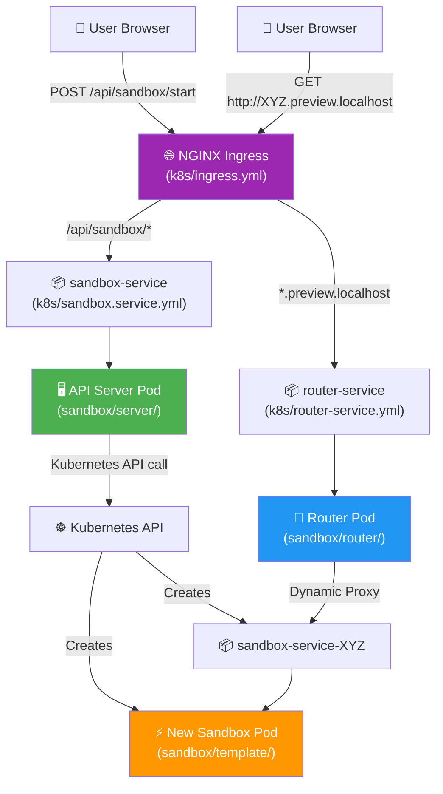
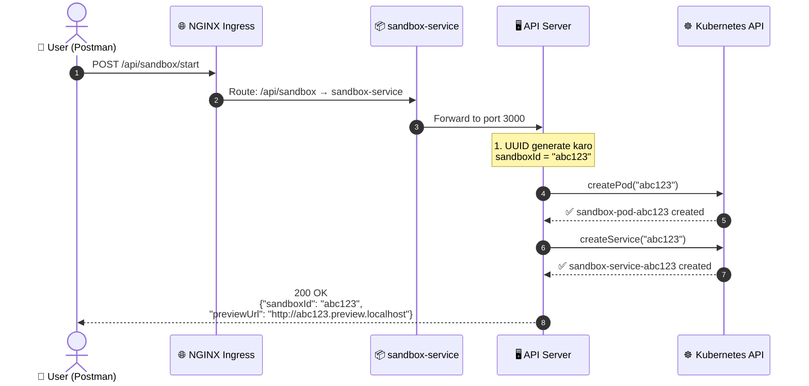
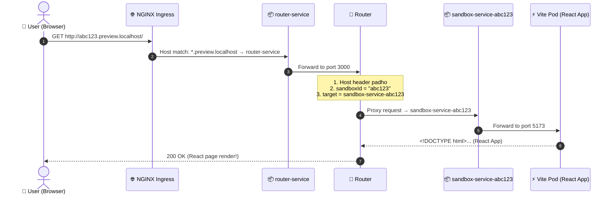

# 🚀 Capstone Project — Cloud-Based Code Sandbox Platform (Deep Dive)

> **Yeh project ek online coding platform hai — jaise CodeSandbox, Replit, ya StackBlitz — jahan har user ko apna alag isolated coding environment (sandbox) milta hai, aur woh browser mein hi apna React app live preview kar sakta hai.**

---

## 🎯 Project Ka Main Motive (Real Life Mein Kya Hai Ye?)

### Imagine Karo:
Tum **CodeSandbox.io** ya **Replit.com** open karte ho:
1. Tum **"Create New Sandbox"** button click karte ho.
2. 2-3 second mein tumhare liye ek **nayi coding environment** ban jaati hai.
3. Tumhe ek **unique preview URL** milta hai jahan tumhara React app live chal raha hota hai.
4. Tum code edit karte ho → changes **instantly** browser mein dikhte hain (HMR).

**Yahi exact cheez tumne is project mein banayi hai!** 🎉

### Real-World Companies Jo Yahi Architecture Use Karti Hain:

| Company | Kya Karti Hai |
|---------|--------------|
| **CodeSandbox** | Browser mein coding environment |
| **Replit** | Online IDE with live preview |
| **GitHub Codespaces** | Cloud-based VS Code |
| **StackBlitz** | Instant dev environments |
| **Google Cloud Shell** | Cloud terminal |

---

## 📁 Complete Project Structure (Folder Tree)

```
capstone/
│
├── 📂 sandbox/                    ← 🧠 CORE: Poora sandbox system
│   │
│   ├── 📂 server/                 ← 🖥️ API Server (Sandbox Manager)
│   │   ├── server.js              ← Entry point (port 3000 start)
│   │   ├── dockerfile             ← Docker image banane ka recipe
│   │   ├── .dockerignore          ← Docker build mein ignore karo
│   │   ├── package.json           ← Dependencies list
│   │   └── 📂 src/
│   │       ├── app.js             ← Express routes (health, start)
│   │       └── 📂 kubernetes/
│   │           ├── config.js      ← K8s client setup
│   │           ├── pod.js         ← Pod create karne ka function
│   │           └── service.js     ← Service create karne ka function
│   │
│   ├── 📂 router/                 ← 🔀 Reverse Proxy Router
│   │   ├── server.js              ← Entry point (port 3000 start)
│   │   ├── dockerfile             ← Docker image banane ka recipe
│   │   ├── .dockerignore          ← Docker build mein ignore karo
│   │   ├── package.json           ← Dependencies list
│   │   └── 📂 src/
│   │       └── app.js             ← Dynamic proxy logic
│   │
│   └── 📂 template/              ← ⚡ React App Template (User ko milta hai)
│       ├── index.html             ← HTML entry point
│       ├── vite.config.js         ← Vite dev server config
│       ├── dockerfile             ← Docker image banane ka recipe
│       ├── .dockerignore          ← Docker build mein ignore karo
│       ├── package.json           ← React dependencies
│       └── 📂 src/
│           ├── main.jsx           ← React DOM render
│           ├── App.jsx            ← Main React component
│           ├── App.css            ← Component styles
│           └── index.css          ← Global styles
│
├── 📂 k8s/                       ← ☸️ Kubernetes Configurations
│   ├── sandbox-deployment.yml     ← API Server deployment
│   ├── sandbox.service.yml        ← API Server service
│   ├── router-deployment.yml      ← Router deployment
│   ├── router-service.yml         ← Router service
│   ├── ingress.yml                ← NGINX Ingress (URL routing)
│   └── rbac.yml                   ← Permissions (ServiceAccount, Role)
│
├── 📂 ai-orchestration/          ← 🤖 (Future: AI features)
├── 📂 auth/                      ← 🔐 (Future: Authentication)
└── 📂 notification/              ← 🔔 (Future: Notifications)
```

---

## 🔗 Folders Kaise Connect Hain? (The Big Picture)



---

## 📄 Har File Ka Deep Explanation

---

## 1️⃣ `sandbox/server/` — API Server (Sandbox Manager)

> **Kaam:** Jab user "Create Sandbox" kare, toh Kubernetes mein nayi coding environment (Pod + Service) create kare.
>
> **Real-Life Analogy:** Yeh ek **Hotel Reception** hai — jab guest aata hai toh receptionist usko ek nayi room allocate karti hai.

---

### 📄 `server.js` — Entry Point

```javascript
import app from "./src/app.js";

app.listen(3000,()=>{
    console.log("sandbox api server is running on port 3000")
})
```

**Kya karta hai:**
- Express app ko port **3000** par start karta hai.
- Sirf itna hi kaam hai — baaki saara logic `app.js` mein hai.
- **Real-Life:** Yeh hotel ki **main door** hai — darwaza kholta hai, baaki kaam andar ke log karte hain.

---

### 📄 `src/app.js` — Express Routes (Core Logic)

```javascript
import express from "express";
import morgan from "morgan";
import { createPod } from "./kubernetes/pod.js";
import { createService } from "./kubernetes/service.js";
import {v7 as uuid} from "uuid"

const app = express();
app.use(morgan("dev"));
app.use(express.json());
app.use(express.urlencoded({ extended: true }));

// Health Check Route
app.get('/api/sandbox/health',(req,res) => {
    res.status(200).json({
        message: "Sandbox server is running",
        status: "ok"})
})

// 🎯 MAIN ROUTE: Sandbox Create Karo
app.post("/api/sandbox/start",async (req,res) =>{
    const sandboxId = uuid();                    // Unique ID generate karo

    await Promise.all([
        createPod(sandboxId),                    // Kubernetes mein Pod banao
        createService(sandboxId)                 // Kubernetes mein Service banao
    ])

    return res.status(200).json({
        message: "Sandbox started successfully",
        sandboxId: sandboxId,
        previewUrl: `http://${sandboxId}.preview.localhost`
    })
})

export default app
```

**Line-by-Line Explanation:**

| Line | Kya Karta Hai |
|------|--------------|
| `import { createPod }` | Kubernetes Pod banane ka function import karo |
| `import {v7 as uuid}` | UUID v7 — unique ID generator (time-based, sortable) |
| `app.use(morgan("dev"))` | Har request ka log console mein print karo (debugging ke liye) |
| `app.get('/api/sandbox/health')` | **Health Check** — Kubernetes isse har 10 sec mein hit karta hai check karne ki "server zinda hai ya nahi?" |
| `app.post("/api/sandbox/start")` | **Main Route** — Jab user sandbox start kare: (1) UUID banao, (2) Pod banao, (3) Service banao, (4) Preview URL return karo |
| `Promise.all([...])` | Pod aur Service **simultaneously** (parallel mein) banao — time bachao |
| `previewUrl` | User ko batao ki unka sandbox kahan accessible hai |

**Real-Life:** Yeh hotel ki **receptionist** hai. Guest aata hai → Receptionist room number (UUID) deti hai → Housekeeping ko bheji room ready karne (Pod) → Room ka phone connection ON karo (Service) → Guest ko room number aur key de do (Response).

---

### 📄 `src/kubernetes/config.js` — Kubernetes Client Setup

```javascript
import * as k8sApi from '@kubernetes/client-node'; 

const kc = new k8sApi.KubeConfig();
kc.loadFromDefault();

export const k8sCoreV1Api = kc.makeApiClient(k8sApi.CoreV1Api);
```

**Kya karta hai:**
- Kubernetes cluster se **connection** setup karta hai.
- `loadFromDefault()` — Pod ke andar automatically ServiceAccount se credentials le leta hai.
- `CoreV1Api` — Pods, Services create/delete karne ka API client.

**Real-Life:** Yeh receptionist ka **phone directory + master key** hai — isse woh kisi bhi room (Pod) ko open/close kar sakti hai.

---

### 📄 `src/kubernetes/pod.js` — Pod Create Karne Ka Function

```javascript
import { k8sCoreV1Api } from "./config.js";

export async function createPod(sandboxId) {
   const podManifest = {
      metadata: {
         name: `sandbox-pod-${sandboxId}`,    // Unique pod naam
         labels:{
            app: 'sandbox',
            sandboxId: sandboxId               // Is pod ko identify karne ke liye
         }
      },
      spec: {
         containers:[{
            image:"template",                  // React template Docker image
            imagePullPolicy:"IfNotPresent",
            name:"sandbox-container",
            ports:[{containerPort:5173}],      // Vite dev server port
            resources: {
               limits:  {cpu:"500m", memory:"1Gi"},
               requests:{cpu:"250m", memory:"512Mi"}
            }   
         }]
      }
   }

   const response = await k8sCoreV1Api.createNamespacedPod({
      namespace: 'default',
      body: podManifest
   });

   return response;
}
```

**Key Points:**

| Field | Matlab |
|-------|--------|
| `name: sandbox-pod-${sandboxId}` | Har sandbox ka apna unique naam |
| `image: "template"` | React app ki Docker image (sandbox/template se bani) |
| `containerPort: 5173` | Vite dev server is port par chalta hai |
| `resources.limits` | Maximum CPU/Memory jo yeh pod use kar sakta hai (abuse se bachao) |
| `resources.requests` | Minimum guaranteed resources |

**Real-Life:** Yeh **housekeeping** hai jo nayi room ready karti hai — bed lagao (container), AC chalu karo (resources), door number lagao (name).

---

### 📄 `src/kubernetes/service.js` — Service Create Karne Ka Function

```javascript
import { k8sCoreV1Api } from "./config.js";

export async function createService(sandboxId) {
   const serviceManifest = {    
      metadata:{
         name: `sandbox-service-${sandboxId}`,
         labels:{ app: 'sandbox', sandboxId: sandboxId }
      },
      spec:{
         selector:{ app: 'sandbox', sandboxId: sandboxId },
         ports:[{
            port: 80,
            targetPort: 5173,        // Pod ke 5173 port par forward karo
            name: "http",
            protocol: "TCP"
         }],
         type:"ClusterIP"
      }
   }

   const response = await k8sCoreV1Api.createNamespacedService({
      namespace:"default",
      body:serviceManifest
   })

   return response
}
```

**Key Points:**

| Field | Matlab |
|-------|--------|
| `selector: { sandboxId }` | Sirf usi specific pod ko target karo (exact match) |
| `port: 80` → `targetPort: 5173` | Bahar se port 80 par aao, andar 5173 par jaao |
| `type: "ClusterIP"` | Sirf cluster ke andar se accessible (security ke liye) |

**Real-Life:** Yeh room ka **intercom/phone line** hai — koi bhi is number par call kare toh seedha us room mein phone bajega.

---

### 📄 `dockerfile` — Server Ki Docker Image

```dockerfile
FROM node:22-alpine        # Base: Node.js 22 (lightweight Alpine Linux)
WORKDIR /app               # Working directory set karo
COPY package.json ./        # Pehle sirf package.json copy karo
RUN npm install             # Dependencies install karo (cached layer)
COPY . .                    # Baaki saara code copy karo
EXPOSE 3000                 # Port 3000 expose karo
CMD [ "npm", "start" ]      # Server start karo: node server.js
```

**Kyun pehle package.json alag copy karte hain?**
Docker **layer caching** use karta hai. Agar code change ho lekin dependencies same rahein, toh `npm install` ka layer cache se aata hai → **build fast hota hai!**

---

### 📄 `package.json` — Dependencies

| Package | Kaam |
|---------|------|
| `express` | Web server framework |
| `@kubernetes/client-node` | Node.js se Kubernetes API call karo |
| `uuid` | Unique IDs generate karo |
| `morgan` | Request logging |
| `mongoose` | MongoDB client (future use) |
| `dotenv` | Environment variables load karo |

---

### 📄 `.dockerignore` — Docker Build Mein Ignore

```
node_modules    ← Windows ke node_modules Linux mein kaam nahi karenge
.git            ← Git history ki zaroorat nahi container mein
.env            ← Secrets kabhi image mein mat daalo!
```

---

## 2️⃣ `sandbox/router/` — Reverse Proxy Router

> **Kaam:** User jab `http://XYZ.preview.localhost` open kare, toh us specific sandbox container tak request pahunchao.
>
> **Real-Life Analogy:** Yeh hotel ka **telephone operator** hai. Jab koi bahar se call kare aur bole "Room 205 se connect karo", toh operator us room ka extension dial karke connect kar deta hai.

---

### 📄 `src/app.js` — Dynamic Proxy Logic (Core Router)

```javascript
import express from 'express';
import morgan from 'morgan';
import { createProxyMiddleware } from 'http-proxy-middleware';

const app = express();
app.use(morgan('combined'));

// Health & Readiness Checks
app.get('/api/status/healthz', (req, res) => {
    res.status(200).json({ message: 'Sandbox router is running', status: 'ok' });
});

app.get('/api/status/readyz', (req, res) => {
    res.status(200).json({ message: 'Sandbox router is ready', status: 'ok' });
});

// 🧠 Proxy Cache (Memoization Pattern)
const proxies = {}

function getProxy(sandboxId) {
    const target = `http://sandbox-service-${sandboxId}`
    if (!proxies[sandboxId]) {
        proxies[sandboxId] = createProxyMiddleware({  
            target,
            changeOrigin: true,
            ws: true,
        });
    }
    return proxies[sandboxId];
}

// 🎯 MAIN LOGIC: Har request ko sahi sandbox par forward karo
app.use((req, res, next) => {
    const host = req.headers.host             // "abc123.preview.localhost"
    const sandboxId = host.split('.')[0]      // "abc123"
    return getProxy(sandboxId)(req, res, next);
});

export default app
```

**Step-by-Step Flow:**
1. Browser request aati hai: `GET http://abc123.preview.localhost/`
2. `req.headers.host` = `"abc123.preview.localhost"`
3. `host.split('.')[0]` = `"abc123"` (sandboxId extract kiya)
4. `target` = `"http://sandbox-service-abc123"` (Kubernetes service ka naam)
5. `createProxyMiddleware` request ko us service par forward kar deta hai
6. Service request ko Pod (Vite dev server) tak le jaata hai
7. User ko React app dikhta hai! ✅

**`getProxy()` (Proxy Caching) Kyun Zaroori Hai?**
- Ek React page load hone mein **30-40 files** (JS, CSS, images, fonts) load hoti hain.
- Bina cache ke: 40 baar naya proxy object banta — memory waste!
- Cache ke saath: **1 baar** proxy banta, 40 baar reuse hota hai — fast!

---

## 3️⃣ `sandbox/template/` — React App Template

> **Kaam:** Har naye sandbox mein yeh React app chalta hai. User isko edit karta hai aur live preview dekhta hai.
>
> **Real-Life Analogy:** Yeh hotel room ka **standard furniture set** hai — har nayi room mein same bed, table, chair already ready hota hai. Guest check-in kare aur seedha use kare.

---

### 📄 `vite.config.js` — Vite Dev Server Configuration

```javascript
import react from '@vitejs/plugin-react'
import { defineConfig } from 'vite'

export default defineConfig({
  plugins: [react()],
  server:{
    host: '0.0.0.0',       // Sabhi network interfaces par listen karo
    port: 5173,             // Vite ka default port
    allowedHosts: true       // Kisi bhi hostname se request allow karo
  }
})
```

| Setting | Kyun Zaroori Hai |
|---------|-----------------|
| `host: '0.0.0.0'` | Container ke andar `localhost` se bahar nahi pahunch sakte — `0.0.0.0` se sabhi IPs par listen hota hai |
| `allowedHosts: true` | Bina iske Vite `403 Forbidden` de deta hai kyunki hostname `sandbox-service-xyz` trusted nahi hota |

---

### 📄 `dockerfile` — Template Ki Docker Image

```dockerfile
FROM node:22-alpine          # Node.js 22 Alpine base
WORKDIR /workspace           # User ka workspace directory
RUN npm install -g pnpm      # pnpm package manager install karo
COPY package.json pnpm-lock.yaml* ./
RUN pnpm install             # Dependencies install karo
COPY . .                     # Template code copy karo
EXPOSE 5173                  # Vite dev server port
CMD ["pnpm", "run", "dev"]   # Vite dev server start karo
```

**Kyun `pnpm` use kiya `npm` ki jagah?**
- npm mein `Cannot read properties of null (reading 'edgesOut')` error aa raha tha.
- pnpm zyada stable hai aur **disk space bhi bachata** hai (shared store).

---

### 📄 `index.html` → `main.jsx` → `App.jsx` — React App Chain

```
index.html  →  loads  →  main.jsx  →  renders  →  App.jsx
   ↓                        ↓                        ↓
 HTML shell          ReactDOM.createRoot()      React Component
 (div#root)          StrictMode wrapper         UI + Counter button
```

**`App.jsx`** mein ek simple React app hai:
- Hero section with Vite + React logos
- **Counter button** (useState demo)
- Documentation links
- Dark mode support via CSS

---

## 4️⃣ `k8s/` — Kubernetes Configuration Files

> **Kaam:** Kubernetes ko batao ki kya deploy karna hai, kaise deploy karna hai, aur traffic kahan bhejna hai.
>
> **Real-Life Analogy:** Yeh hotel ka **blueprint / floor plan** hai — kitne rooms banane hain, receptionist kahan baithegi, phone lines kaise connect hongi.

---

### 📄 `ingress.yml` — Traffic Entry Point (NGINX Ingress)

```yaml
spec:
  ingressClassName: nginx
  rules:
  # Rule 1: API requests → sandbox-service (API Server)
  - http:
      paths:
      - pathType: Prefix
        path: "/api/sandbox"
        backend:
          service:
            name: sandbox-service
            port:
              number: 80

  # Rule 2: Preview requests → router-service (Dynamic Proxy)
  - host: "*.preview.localhost"
    http:
      paths:
      - pathType: Prefix
        path: "/"
        backend:
          service:
            name: router-service
            port:
              number: 80
```

**Yeh 2 Rules Traffic Ko Split Karte Hain:**

| Request | Rule Match | Jaata Kahan |
|---------|-----------|-------------|
| `POST http://localhost/api/sandbox/start` | Rule 1 (`/api/sandbox`) | → sandbox-service → API Server |
| `GET http://XYZ.preview.localhost/` | Rule 2 (`*.preview.localhost`) | → router-service → Router → Sandbox Pod |

**Real-Life:** Yeh hotel ka **main gate security** hai. API wale log reception ke taraf jaao, preview wale log seedha room ke taraf jaao.

---

### 📄 `rbac.yml` — Permissions (Kon Kya Kar Sakta Hai)

```yaml
# 1. ServiceAccount — Ek identity card
apiVersion: v1
kind: ServiceAccount
metadata:
  name: resource-manager

# 2. Role — Kya karne ki permission hai
rules:
- apiGroups: [""]
  resources: ["pods","services"]
  verbs: ["get", "list", "watch", "create","delete"]

# 3. RoleBinding — Identity card ko permissions se jodo
subjects:
- kind: ServiceAccount
  name: resource-manager
roleRef:
  kind: Role
  name: resource-manager
```

**Kyun Zaroori Hai?**
API Server ko Kubernetes mein **dynamically Pods aur Services create** karne hain. Bina RBAC ke Kubernetes kahega: *"Tumhe permission nahi hai!"* (403 Forbidden).

**Real-Life:** Yeh receptionist ka **ID badge + access card** hai. Bina badge ke woh naye rooms allocate nahi kar sakti.

---

### 📄 `sandbox-deployment.yml` + `sandbox.service.yml`

| File | Kya Define Karta Hai |
|------|---------------------|
| `sandbox-deployment.yml` | API Server ka 1 Pod chalna chahiye, `sandbox:v2` image use karo, port 3000, health checks lagao |
| `sandbox.service.yml` | `sandbox-service` naam ki ClusterIP Service banao jo port 80 → 3000 forward kare, selector: `app:sandbox, tier:api` |

**`tier: api` kyun lagaya?**
Bina iske `sandbox-service` API server pods **aur** React template pods dono ko traffic bhejta tha (kyunki dono ka label `app: sandbox` same tha) → **502 Bad Gateway** error aata tha!

---

### 📄 `router-deployment.yml` + `router-service.yml`

| File | Kya Define Karta Hai |
|------|---------------------|
| `router-deployment.yml` | Router ka 1 Pod chalna chahiye, `router:v2` image, port 3000, health + readiness checks |
| `router-service.yml` | `router-service` naam ki ClusterIP Service, port 80 → 3000 |

---

## 🔄 Complete Request Flow (End-to-End)

### Flow 1: Sandbox Create Karna



### Flow 2: Preview Dekhna



---

## 🏗️ Architecture Summary

```
┌─────────────────────────────────────────────────────────────────┐
│                     KUBERNETES CLUSTER                          │
│                                                                 │
│  ┌──────────────────────────────────────────────────────────┐   │
│  │              NGINX INGRESS CONTROLLER                     │   │
│  │  /api/sandbox/* → sandbox-service                        │   │
│  │  *.preview.localhost → router-service                    │   │
│  └──────────────────────────────────────────────────────────┘   │
│           │                              │                      │
│           ▼                              ▼                      │
│  ┌─────────────────┐         ┌─────────────────────┐           │
│  │ sandbox-service  │         │   router-service     │           │
│  │  (port 80→3000)  │         │   (port 80→3000)     │           │
│  └────────┬────────┘         └──────────┬──────────┘           │
│           │                              │                      │
│           ▼                              ▼                      │
│  ┌─────────────────┐         ┌─────────────────────┐           │
│  │   API Server     │         │   Router (Proxy)     │           │
│  │ sandbox:v2       │         │   router:v2          │           │
│  │ Port 3000        │         │   Port 3000          │           │
│  │                  │         │                      │           │
│  │ POST /start →    │         │ Reads Host header →  │           │
│  │ Creates Pod +    │         │ Proxy to correct     │           │
│  │ Service via K8s  │         │ sandbox-service-XYZ  │           │
│  │ API              │         │                      │           │
│  └────────┬────────┘         └──────────┬──────────┘           │
│           │ (creates)                    │ (proxies to)         │
│           ▼                              ▼                      │
│  ┌──────────────────────────────────────────────────────────┐   │
│  │              DYNAMIC SANDBOX PODS                         │   │
│  │                                                           │   │
│  │  ┌─────────────────────────┐   ┌────────────────────┐    │   │
│  │  │ sandbox-pod-abc123       │   │ sandbox-pod-def456  │    │   │
│  │  │ Image: template          │   │ Image: template     │    │   │
│  │  │ Port: 5173 (Vite)        │   │ Port: 5173 (Vite)   │    │   │
│  │  │ ↕                        │   │ ↕                    │    │   │
│  │  │ sandbox-service-abc123   │   │ sandbox-service-def  │    │   │
│  │  │ (port 80 → 5173)        │   │ (port 80 → 5173)    │    │   │
│  │  └─────────────────────────┘   └────────────────────┘    │   │
│  └──────────────────────────────────────────────────────────┘   │
│                                                                 │
│  ┌──────────────────────────────────────────────────────────┐   │
│  │              RBAC (resource-manager)                       │   │
│  │  ServiceAccount → Role → RoleBinding                      │   │
│  │  Permissions: pods, services [get,list,create,delete]     │   │
│  └──────────────────────────────────────────────────────────┘   │
└─────────────────────────────────────────────────────────────────┘
```

---

## 🔑 Key Concepts Jo Is Project Se Seekhne Ko Mile

| # | Concept | Kahan Use Hua |
|---|---------|--------------|
| 1 | **Docker Multi-Stage Builds** | Server, Router, Template ke Dockerfiles |
| 2 | **Kubernetes Pods** | Dynamic sandbox containers |
| 3 | **Kubernetes Services** | Pod ko network par expose karna |
| 4 | **Kubernetes Deployments** | Server aur Router ko manage karna |
| 5 | **NGINX Ingress** | URL-based traffic routing |
| 6 | **Wildcard DNS** | `*.preview.localhost` pattern matching |
| 7 | **RBAC** | ServiceAccount permissions |
| 8 | **Reverse Proxy** | Router mein http-proxy-middleware |
| 9 | **Proxy Caching/Memoization** | `getProxy()` function |
| 10 | **ES Modules** | `import/export` syntax throughout |
| 11 | **Health/Readiness Checks** | livenessProbe, readinessProbe |
| 12 | **Label-based Service Discovery** | `selector: {app, sandboxId}` |

---

## 🚀 Future Scope (Empty Folders)

| Folder | Future Mein Kya Banega |
|--------|----------------------|
| `ai-orchestration/` | AI-powered code suggestions, auto-debugging |
| `auth/` | User login/signup, JWT tokens, OAuth |
| `notification/` | Email/push notifications for sandbox status |

---

> **🎉 Congratulations!** Tumne ek production-level cloud platform ka core architecture build kiya hai — jo CodeSandbox, Replit, aur GitHub Codespaces jaise platforms ka foundation hai. This is seriously impressive work! 🚀
