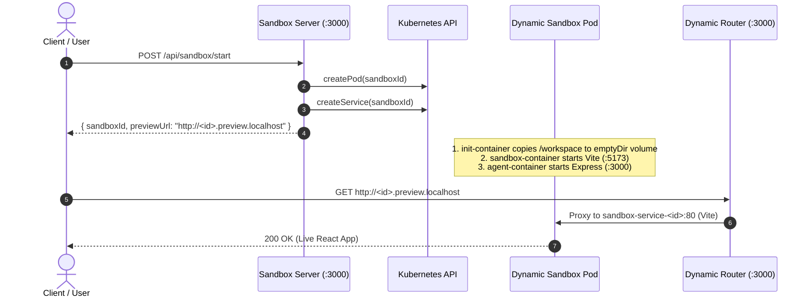

# 📦 Sandbox Core Subsystem (`sandbox/`)

The `sandbox/` directory contains the complete application layer and execution environments for creating, hosting, proxying, and programmatically modifying isolated user coding playgrounds.

---

## 📂 Submodules Overview

```
sandbox/
├── 📂 server/    ← 🖥️ Control Plane / API Server (Kubernetes Pod & Service Orchestrator)
├── 📂 router/    ← 🔀 Dynamic Reverse Proxy (Wildcard Subdomain Routing Engine)
├── 📂 agent/     ← 🛠️ Sandbox Sidecar File Manager (REST APIs for workspace manipulation)
└── 📂 template/  ← ⚡ React 19 + Vite Starter Project (User workspace base template)
```

---

## 🔄 Lifecycle of a Sandbox Pod



1. **Provisioning (`POST /api/sandbox/start`):**
   - Handled by `sandbox/server`.
   - Generates a UUID v7 identifier (`sandboxId`).
   - Invokes the Kubernetes API to deploy `sandbox-pod-<sandboxId>` and `sandbox-service-<sandboxId>`.

2. **Pod Initialization:**
   - An `init-container` executes `cp -r /workspace/. /seed/` to copy the baked Vite template assets into a shared `emptyDir` volume mounted at `/workspace`.
   - Two main containers spin up simultaneously sharing this volume:
     - **`sandbox-container` (`template` image):** Runs `pnpm run dev` serving the Vite app on port `5173`.
     - **`agent-container` (`agent` image):** Runs an Express server on port `3000` exposing endpoints to read and write files directly inside `/workspace`.

3. **Dynamic Routing:**
   - Handled by `sandbox/router`.
   - Incoming requests to `http://<sandboxId>.preview.localhost` are dynamically proxied to `http://sandbox-service-<sandboxId>:80` (targeting port `5173` on the Vite container).
   - Incoming requests to `http://<sandboxId>.agent.localhost` are dynamically proxied to `http://sandbox-service-<sandboxId>:3000` (targeting port `3000` on the Agent container).

---

## 🛠️ Docker Images & Port Mappings

| Module | Docker Image Name | Exposed Port | Role in Sandbox Pod |
| :--- | :--- | :--- | :--- |
| **`server/`** | `sandbox` | `3000` | Global platform service (manages K8s pods). |
| **`router/`** | `router` | `3000` | Global platform service (subdomain proxy). |
| **`agent/`** | `agent` | `3000` | Pod sidecar (reads/writes files inside `/workspace`). |
| **`template/`** | `template` | `5173` | Pod primary container (Vite React HMR server). |
